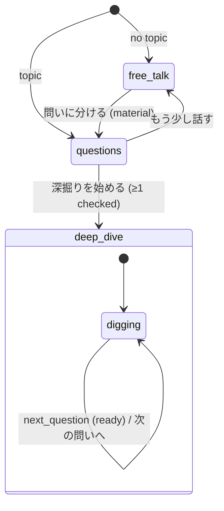

# Free talk → question list → per-question dives — DMMF implementation record

Repository: nowly-lab/why-why-talk, branch `yuki.matsuyama/free-talk-questions` (from `86c1c69`). Current model (SSoT): [`docs/domain-model/`](../../../docs/domain-model/index.html). Spec: [`docs/superpowers/specs/2026-11-16-free-talk-questions-design.md`](../../../docs/superpowers/specs/2026-11-16-free-talk-questions-design.md). The plan of record is the HTML plan linked from the PR. Everything is in one file because this is one small bounded context plus one new external context (Gemini text model).

## 1. Implementation Slice

Start without a topic (or with one) → free talk (segmented audio → text model transcription) and files (drag or `--attach` → summary) → split into ≤10 questions → the person checks and edits → deep dive: checked questions become roots `q1…`, Gemini Live digs one at a time and moves on with `next_question` when the question is ready → per-question result.

## 2. Workflow State

`TalkSession` (`src/talk/session.ts`) gains `phase: "free_talk" | "questions" | "deep_dive"`, `topic: string | null`, `freeTalk: TranscriptEntry[]`, `files: FileSummary[]`, `questions: Question[]`, `dives: Dive[]` (`questionId`, `text`, `status: pending | digging | done | partial`, `draft`). The single `draft`/`sent` direction is replaced by per-dive drafts. The why tree (`Analysis`, `src/model.ts`) keeps its Zod schema; roots are nodes with `parentId: null` (`q1…`). HTTP bodies are parsed with Zod in `src/talk/server.ts`; tool args with Zod in `src/talk/tools.ts`; the text model's question list with a Zod schema in `src/talk/text-model.ts`.

## 3. State Transitions

Mirrored in `docs/domain-model/data/workflow-models.json` (`phase-life`, `dive-life`, `session-life`).

- Phase: `free_talk → questions` (split, guard `hasMaterial()`), `questions → questions` (re-split, edit, file), `questions → free_talk` (back), `questions → deep_dive` (start, guard ≥1 checked). Starting with a topic begins in `questions`.
- Dive: `pending → digging` (start or previous one finished), `digging → done` (`next_question` by Gemini, guard `questionReady`), `digging → partial` (the person's button). Tools on a non-current question are refused.
- Session: `talking → sent | cancelled` as before; send allowed from any phase, requires a direction only for `done` dives.

## 4. Pipeline Steps

1. `main` (`src/cli.ts`): parse args (`--topic?`, `--attach*`), `readAttachment` each, `summarizeFile` each, build session and `startTalkServer` with `text: geminiTextModel(...)`.
2. `/api/audio` → `transcribe` → `appendFreeTalk` → persist.
3. `/api/file` → `checkAttachment` → `summarizeFile` → `addFile` → persist.
4. `/api/questions/split` → guard `hasMaterial` → `splitQuestions` → `setQuestions` → persist. `/api/questions` → `editQuestions`.
5. `/api/dive/start` → `startDeepDive` (adds roots) → page connects Live (`/api/token`, allowed only in `deep_dive`).
6. Tool calls → `applyTool` (current-question guard) → `next_question` → `advance("gemini")` (guard `questionReady`). `/api/dive/next` → `advance("person")`.
7. `/api/submit` → `submit(directions)` → `renderResultMarkdown`.

## 5. Dependencies And Edges

Injected: `text: TextModel` (tests pass a fake object; production `geminiTextModel({ apiKey, model, generate? })` with `generate` injectable), `mint`, `now`. The API key stays in the CLI process. Recorded audio never touches disk (browser memory until transcribed).

## 6. Error / Effect Model

- Domain refusals (wrong phase, no checked question, too many questions, unsupported file, question not ready) are `WhyError` → 400/409 at the adapter; for tools they are returned data `{ ok: false, error }` so Gemini can retry.
- Text model failures (network, malformed JSON) are thrown from the adapter as `TextModelError` and translated to **502** at the HTTP adapter (business kind "upstream", transport status override) so the page offers a retry and the phase does not change.
- The outcome stays a value mapped to exit codes 0/1/2.

## 7. Serialization / Persistence Impact

`session.json` gains phase, freeTalk, files (summaries only, never file bytes), questions, dives. `transcript.md` gets a free-talk section. `result.md`/`result.json` become per-question (`questions[]`, no compatibility layer; the only reader is the skill, updated in the same change). Everything passes `redactSecrets`.

## 8. TypeScript Implementation Example

```ts
case "/api/questions/split": {
  if (!s.hasMaterial()) throw new WhyError("invalid_input", "話した内容がありません");
  const texts = await deps.text.splitQuestions(s.splitInput()); // TextModelError → 502 below
  s.setQuestions(texts);
  await s.persist();
  return json(res, 200, { questions: s.questions });
}
```

## 9. Mermaid Diagrams



## 10. Tests

Listed per task in the plan: `test/analysis.test.ts` (roots, `questionReady`), `test/text-model.test.ts`, `test/attachments.test.ts`, `test/session.test.ts` (phases, dives, guards, result), `test/gemini.test.ts` (brief), `test/http.test.ts` (endpoints, body limits, 502), `test/cli.test.ts` (optional topic, `--attach`), `test/recorder.test.ts`, `test/web-logic.test.ts`. Real Gemini: `scripts/text-smoke.ts`, `scripts/live-smoke.ts`. Browser E2E with a fake mic fed a Japanese WAV.

## 11. Open Questions

- Do segment boundaries drop words in real speech (hotspot `hs-segment`)? Voice trial.
- How long is acceptable for 10 questions × 5 levels (hotspot `hs-length`)? Voice trial.
- Resolved: screen layouts chosen from reference images (all A: talk left / files right, checklist rows, question sidebar).

## Verified (2026-11-16)

`npm test` 257 pass, `npm run typecheck`, `npm run build`; `scripts/text-smoke.ts` 4/4 ok; `scripts/live-smoke.ts` shows `propose_direction, next_question` and the move to q2; fake-mic browser E2E through all three phases and the `--topic --attach` path; `domain-model.mjs check --repo` passes. Actual extra code beyond the plan: `web/free-talk.ts` (`createFreeTalk`), the ready note on `propose_direction`, `current` in every tool answer (`web/api.ts` `toGeminiResponse`).
