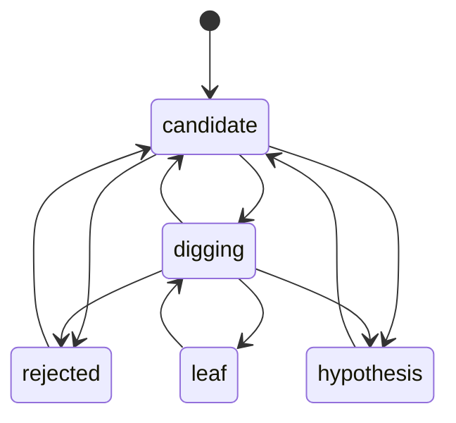

# why-why-mcp v1 — DMMF implementation record

Repository: nowly-lab/why-why-mcp, branch `yuki.matsuyama/initial-mcp`. Current model (SSoT): [`docs/domain-model/`](../../../docs/domain-model/index.html). Spec: [`docs/superpowers/specs/2026-11-13-why-why-mcp-design.md`](../../../docs/superpowers/specs/2026-11-13-why-why-mcp-design.md).

All required sections are kept in this one file because the product is one small bounded context (ruling recorded in the planning owner record).

## 1. Implementation Slice

The whole first version: the analysis workflow (start → branch → evidence → evaluate/judge → dig → leaf/stop → close) and its rendering for the Plannotator Inbox. Paths are inspected (implemented), not proposed.

## 2. Workflow State

`Analysis` (`src/model.ts`, Zod `AnalysisSchema`): id, title, problem, `status: open | closed`, `nodes: WhyNode[]`, timestamps. `WhyNode`: id, parentId (`null` for the root `n0`), text, viewpoint, `state: candidate | digging | leaf | rejected | hypothesis`, evidence, evaluation (per-field `{ value, source, lowConfidence, at }`, `stale`, `history`), reason, countermeasure.

## 3. State Transitions

Defined once in `ALLOWED` (`src/analysis.ts`) and mirrored in `docs/domain-model/data/workflow-models.json` (`node-life`, `analysis-life`). Invalid moves raise `WhyError("invalid_state")`; missing reason/countermeasure raise `invalid_input`.

## 4. Pipeline Steps

Every MCP tool is the same pipeline (`src/server.ts`, helper `change`):

1. Zod parses the tool arguments at the adapter (SDK `registerTool` input shapes).
2. `FileStore.load` reads and Zod-parses the stored analysis (`src/store.ts`).
3. A pure domain function returns a new `Analysis` (`startAnalysis`, `addWhys`, `addEvidence`, `applyFieldValues`, `updateNode`, `closeAnalysis`), or a pure query (`nextBranch`).
4. `evaluate` only: the Clef edge (`evaluateWithClef`, `src/clef.ts`) runs between load and save.
5. `FileStore.save(analysis, loaded.updatedAt)` persists atomically, refusing a stale version.
6. The adapter returns JSON text; a `WhyError` becomes `isError: true` with `<code>: <message>`.

## 5. Dependencies And Edges

Injected at `createWhyWhyServer(deps)`: `store` (FileStore), `clef` (config or null), `fetchFn`, `now`, `threshold`. `src/index.ts` builds them from the environment. Redaction (`redactSecrets`) runs inside the domain functions, so the store, Clef and renderers only ever see masked text.

## 6. Error / Effect Model

- Domain refusals: `WhyError` codes `not_found`, `invalid_state`, `invalid_input`, `conflict`, `duplicate`; translated by the adapter, never a custom Result.
- Clef failures are returned data (`needsJudgment` with `why`), not throws, so a model outage only means the agent judges.
- Unexpected errors (I/O) propagate to the SDK as tool errors.

## 7. Serialization / Persistence Impact

One JSON per analysis at `<WHY_WHY_DIR>/<id>.json`, written to a temp file and renamed under a `mkdir` lock; the stored file is re-validated with `AnalysisSchema` on load. Renders are derived files (`.mmd`, `.html`). No events are stored separately: the analysis document is the only state.

## 8. TypeScript Implementation Example

```ts
const change = async (id: string, fn: (a: Analysis) => Promise<Changed> | Changed) => {
  const a = await store.load(id);              // boundary parse
  const { analysis, result } = await fn(a);    // pure transition (+ Clef edge for evaluate)
  if (analysis !== a) await store.save(analysis, a.updatedAt); // optimistic concurrency
  return result;
};
```

## 9. Mermaid Diagrams



## 10. Tests

`test/analysis.test.ts` (rules and transitions), `test/redact.test.ts`, `test/store.test.ts` (atomic save, stale write refused, traversal), `test/clef.test.ts` (request shape, parsing, every failure mode), `test/render.test.ts` (escaping, summary, no secrets), `test/server.test.ts` (11 tools, instructions size, full loop with and without Clef).

## 11. Open Questions

- The done threshold (0.2) and the priority formula need tuning with real analyses (hotspot `hs-threshold`).
- Clef's answers depend on the question wording; revisit `QUESTIONS` after a few real runs.
