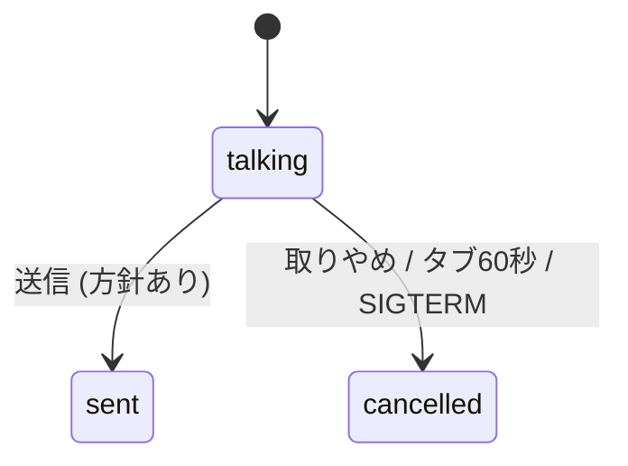

# why-why-talk v2 — DMMF implementation record

Repository: nowly-lab/why-why-talk, branch `yuki.matsuyama/initial-mcp`. Current model (SSoT): [`docs/domain-model/`](../../../docs/domain-model/index.html). Spec: [`docs/superpowers/specs/2026-11-13-why-why-talk-design.md`](../../../docs/superpowers/specs/2026-11-13-why-why-talk-design.md). One file with every required section (one small bounded context).

## 1. Implementation Slice

The whole first version: start a talk (CLI) → connect (token) → talk and grow the tree (tool calls) → organise (draft) → send or cancel.

## 2. Workflow State

`TalkSession` (`src/talk/session.ts`): `status: talking | sent | cancelled`, `analysis` (the why tree, `src/model.ts` Zod `AnalysisSchema`), `transcript`, `draft`, `sent`, `nonce`. Tool arguments are parsed with Zod (`ToolArgs`, `src/talk/tools.ts`); HTTP bodies with Zod in `src/talk/server.ts`.

## 3. State Transitions

Session: `talking → sent` (submit, guard: 方針 not empty), `talking → cancelled` (cancel button, lease lost 60 s, SIGINT/SIGTERM). Anything after that is refused (`WhyError("conflict")` → 409). Node: the table `ALLOWED` in `src/analysis.ts` plus `stoppedAncestor`. Mirrored in `docs/domain-model/data/workflow-models.json`.

## 4. Pipeline Steps

1. `main` (`src/cli.ts`) parses arguments, checks `GEMINI_API_KEY`, builds the session and `startTalkServer`.
2. Page `POST /api/token` → `mintToken` (`src/talk/gemini.ts`): system instruction from the session as it is now, config, single-use token.
3. Browser `connectLive` (`web/live.ts`) talks to Gemini; tool calls → `POST /api/tool` → `TalkSession.applyTool` → pure tree ops → `persist`.
4. Transcripts → `POST /api/transcript` → `appendTranscript` → `persist`.
5. `POST /api/submit` → `submit` → respond to the page, then settle the outcome → CLI prints `renderResultMarkdown` and exits 0.

## 5. Dependencies And Edges

Injected: `mint` (wraps the API key; tests pass a fake), `webRoot`, `leaseGraceMs`, `now`. Gemini is reached only through `mintToken` (Node) and `connectLive` (browser). The filesystem only through `TalkSession.persist` (serialized, atomic renames).

## 6. Error / Effect Model

- Bad tool calls from Gemini are returned data (`{ ok: false, error, tree }`) so Gemini can retry; never thrown.
- Domain refusals are `WhyError` → HTTP 400/409 at the adapter.
- Infrastructure errors propagate to the adapter as 500 (none expected; the concurrent-save race found in E2E was fixed by serializing saves).
- The outcome is a value (`sent` with Markdown, or `cancelled` with a reason), mapped to exit codes 0/1 in the CLI.

## 7. Serialization / Persistence Impact

`<out>/session.json`, `transcript.md`, `tree.mmd` after every change; `result.md`, `result.json` on send. Everything passes `redactSecrets` before writing and printing.

## 8. TypeScript Implementation Example

```ts
case "/api/submit": {
  s.submit(DirectionBody.parse(body));                 // guard + single outcome
  await respondThen(res, () => finish({ kind: "sent", markdown: renderResultMarkdown(s) }));
  return;                                               // the page gets 200 before the CLI closes the server
}
```

## 9. Mermaid Diagrams



## 10. Tests

`test/analysis.test.ts`, `test/redact.test.ts`, `test/render.test.ts` (engine); `test/session.test.ts` (tools, transcript merge, submit rules, result Markdown, redaction, concurrent saves); `test/gemini.test.ts` (brief, truncation, fallback, token config, no key leak); `test/http.test.ts` (nonce, host, lease, single outcome, response before settle); `test/cli.test.ts` (exit codes, files, SIGTERM); `test/web-logic.test.ts` (transcript merge, reconnect policy, PCM, tree rows). Live: `scripts/live-smoke.ts`; browser E2E with a fake mic (recorded in the owner record).

## 11. Open Questions

- Default voice for Japanese (hotspot `hs-voice`), decided after the person's voice trial.
- Whether `/planning-nowly` should name this tool explicitly (deferred by the person).
